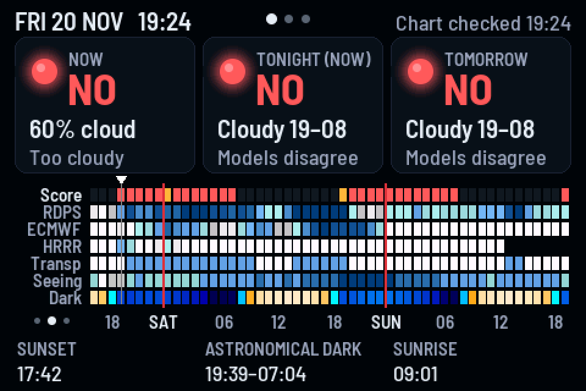

# SkyDisplay

A bedside astronomy forecast display for an ESP32-S3 touchscreen: the WT32-SC01 Plus (3.5", 480×320) or the
Seeed SenseCAP Indicator D1 (4", 480×480).
It answers one question at a glance: is tonight, or tomorrow night, worth setting up the imaging rigs?



## What it shows

- **Forecast:** Now / Tonight / Tomorrow tiles (GO, MAYBE, NO) scored for deep-sky imaging, and a 52-hour strip of
  cloud (RDPS, ECMWF, HRRR), transparency, seeing and darkness. A rotating footer shows the moon phase, moonrise and
  moonset, sunset, astronomical dark, sunrise, peak humidity, calmest wind and seeing.
- **Weather:** current conditions, a 24-hour temperature and dew point trace, dew-risk warning, wind, pressure trend,
  tonight's cloud cover, and a strip with today's daytime forecast (until mid-afternoon), tonight and the next four
  days (day high and low, night-time cloud and chance of precipitation), from a Weather Underground personal weather
  station. The square Indicator screen also shows the text forecast for today (or tonight, later in the day).
- **Observatory** (optional): roll-off roof state, safety verdict with its reason, rain sensor, cloud cover, SQM, sky
  brightness and sky temperature, mount park sensors, and each imaging rig's state from NINA (imaging, waiting,
  finished, lost, inactive). With more than two rigs the list pages, like the footer. See
  `mockup/observatory-screen.html`.
- **Notifications** (optional): messages sent to your Pushover account, e.g. from NINA. One message in full, the
  others as a list; tap the top half for a newer message, the bottom half for an older one. A new message can wake
  the screen and switch to it (a setting), and an emergency message stays up with an Acknowledge button. On the
  Indicator an emergency message can also sound the buzzer (beep-beep every 3 seconds until you tap the screen,
  5 minutes at most). Buttons along the bottom: Sound (Off, High, Med, Low), Monitoring (On, Auto, Off), Clear
  (this message) and Clear all.
  See "Notifications" below.
- **Status:** Wi-Fi, IP address, chart, clock sync and weather status, a QR code for the settings page, and a
  **Refresh now** button (same as "Check chart and weather now" on the settings page).
- **About:** device name and board, firmware version (and the Indicator's buzzer firmware), network, uptime and
  memory, credits, and a QR code for this repository.

Swipe between screens, tap to rotate the footer, long-press to dim. When the screen is dimmed, the first tap wakes it.
The start-up screen is a setting; the display goes back to it after 2 minutes untouched (also a setting; 0 = never). On the Indicator the whole
footer fits on screen at once, so it doesn't rotate.

## Data sources

- **Clear Sky Chart** (Dark Dragons Astronomy): the device downloads the chart GIF and decodes the forecast by
  sampling each cell's colour. There is no text feed for these charts, so a layout change on the site would need an
  update here; the decoder checks the grid and reports a problem rather than showing a wrong forecast.
  Only Dark Dragons chart pages (`https://cds.darkdragonsastro.com/g/<chart id>.html`) are supported; the classic
  cleardarksky.com charts use a different layout.
  Please be considerate with polling (default every 30 minutes) and ask the site's maintainers before using it.
- **Current weather** from an **EcoWitt gateway** on your network (GW1100, GW2000, GW3000; its local
  `get_livedata_info` API, no account or calls), or from a **Weather Underground** personal weather station.
- **Forecast** from the **Weather Underground** API: needs your own API key, entered on the settings page. With an
  EcoWitt gateway a display uses about 24 calls a day; without one, about 170 (the free limit is 1,500 per key).
  The 24-hour temperature trace is built on the device.
- The last chart and weather are kept in flash, so after a restart or firmware update the screens fill at once and
  each part is downloaded only when it is due on its usual schedule.
- **Observatory**, all optional and set on the settings page:
  - ASCOM Alpaca devices: a Dome for the roof, a SafetyMonitor for the safety verdict (Llama Watch's unsafe
    reasons are shown when present), a SafetyMonitor or a UDP safety broadcast for rain, and ObservingConditions for
    the sky. A Find Alpaca devices button runs Alpaca discovery.
  - Mount park sensors and safety sensors that broadcast the Dark Dragons park-sensor JSON on UDP port 23435 are
    picked up automatically.
  - Imaging rigs through N.I.N.A.'s Advanced API plugin (port 1888). NINA only runs while imaging, so a rig that
    doesn't answer is shown as inactive; a finished or lost run stays on screen until a set hour.
- **Sun and moon** times are computed on the device.

## Notifications

The display is an unofficial Pushover Open Client, not released or supported by Pushover. On the settings page, link
it to your account (email and password are used once, to register the display as a device, and not stored), then turn
on the screen. Pushover licenses it like a desktop client: free for 30 days, then a one-time Pushover for Desktop
licence covers it.

- Send to it by its device name (the settings page suggests the display's hostname). A sender that names no device
  reaches every device on the account, displays included.
- **Monitoring** (a switch on the screen and the settings page) connects the display to Pushover. When it's off,
  for example while you're away, the display is silent and messages for it wait on Pushover's servers (up to
  21 days). They arrive quietly when it's back on: only messages under 15 minutes old can wake the screen or sound
  the alarm. **Auto** switches it on now and off by itself at a set hour (noon by default, at least 3 hours later:
  Auto at 21:00 means off at noon the next day); the button then shows "Auto: off 12:00".
- Sound volume (high, medium or low) needs RP2040 firmware v2 on the Indicator; with v1 the Sound button is just
  on and off.
- An emergency message that Pushover repeats until acknowledged is shown once, not once per repeat.
- Acknowledging an emergency on another device (your phone) stops the display's alarm within about 15 seconds: while
  an emergency waits, the display checks Pushover every 15 seconds (Pushover sends no signal for acknowledgements
  made elsewhere).
- Messages are deleted from Pushover once the display has them; it keeps the latest 20 in its own flash.
- Sound needs SkyDisplay's RP2040 firmware on the Indicator: see `firmware/IndicatorRP2040/README.md`.

## Hardware

- WT32-SC01 Plus: ESP32-S3 (2 MB PSRAM, 16 MB flash), ST7796 on an 8-bit parallel bus, FT6336U touch.
- SenseCAP Indicator D1: ESP32-S3 (8 MB octal PSRAM, 8 MB flash), ST7701S on a 16-bit RGB bus, FT6336 touch, PCA9535
  I/O expander. The RP2040 co-processor drives the buzzer; for sound it runs SkyDisplay's own small firmware
  (`firmware/IndicatorRP2040`), otherwise it can keep Seeed's.
- `firmware/SkyDisplay/board.h` picks the board from the PSRAM setting (octal = Indicator); you can force one there.
  It also says what each board has (e.g. `BOARD_HAS_SOUND`); the rest of the code checks those, not the board name.

| | WT32-SC01 Plus | SenseCAP Indicator D1 |
|---|---|---|
| Screen | 3.5" 480×320, footer rotates | 4" 480×480, whole footer and text forecast shown |
| Alarm sound | not yet (speaker connector, I2S) | buzzer, with `firmware/IndicatorRP2040` |
| Notifications storage | FAT partition | LittleFS partition |
| Screen during firmware updates | stays on | backlight off (the RGB panel tears while flash is written) |
- The repository also has HTML mockups in `mockup/`.

## Building

Arduino core esp32 3.3.x with the libraries LovyanGFX, WiFiManager, ArduinoJson, ElegantOTA (3.x) and
WebSockets (Markus Sattler, 2.7.x).
AnimatedGIF is bundled in `firmware/SkyDisplay/src/gif` with a wider line limit (see `VENDORED.txt`).
Board "ESP32S3 Dev Module" with these options:

| | WT32-SC01 Plus | SenseCAP Indicator D1 |
|---|---|---|
| USB CDC on boot | Enabled | Disabled |
| USB mode | Hardware CDC and JTAG | (default) |
| Flash size | 16MB | 8MB |
| Partition scheme | 16M Flash (3MB APP/9.9MB FATFS) | 8M with spiffs (3MB APP/1.5MB SPIFFS) |
| PSRAM | QSPI PSRAM | OPI PSRAM |
| Serial monitor | 115200 | 460800 |

```
arduino-cli compile -b esp32:esp32:esp32s3:CDCOnBoot=cdc,USBMode=hwcdc,FlashSize=16M,FlashMode=qio,PartitionScheme=app3M_fat9M_16MB,PSRAM=enabled firmware/SkyDisplay
arduino-cli compile -b esp32:esp32:esp32s3:CDCOnBoot=default,FlashSize=8M,FlashMode=qio,PartitionScheme=default_8MB,PSRAM=opi firmware/SkyDisplay
arduino-cli upload -p <port> -b <same as above> firmware/SkyDisplay
```

On the Indicator, use the USB-C port's ESP32-S3 serial device (a CH340), not the RP2040's.

After the first flash over USB, updates can go over Wi-Fi: on the settings page, Update firmware (`/firmware`) opens
the ElegantOTA upload page. Upload the compiled `.bin` (Arduino IDE: Sketch > Export Compiled Binary, or
`arduino-cli compile --output-dir`). Use the file without "merged" in its name, built for the same board.

Tools (Python 3 with Pillow):
- `tools/make_fonts.py` regenerates `fonts.h` from the TrueType files in `tools/fonts`.
- `tools/flash_and_shot.ps1 -Board wt32|indicator` (PowerShell) builds, flashes and saves a screenshot over USB serial;
  `tools/shot_to_png.py` converts the raw screenshot.

## First run

1. With no Wi-Fi saved, the display opens a `SkyDisplay-Setup` network and shows two QR codes: one joins that
   network from a phone camera, the other opens the setup page (`http://192.168.4.1/`). Pick your Wi-Fi network there.
2. Once connected, the display shows a QR code for its settings page (`http://skydisplay.local/`, or its IP).
   Enter your Clear Sky Chart ID (e.g. `abcde` from `https://cds.darkdragonsastro.com/g/abcde.html`; the full link
   works too), your time zone and NTP servers and, optionally, your Weather Underground station and key.
3. Latitude and longitude come from the chart by default. **Use my location** on the settings page fills them in
   from your phone's GPS instead (see Limitations about the certificate warning).

## Limitations

- HTTPS certificates are not verified yet (the chart site and the weather API are reached with TLS, unverified).
- The settings page is plain HTTP on your local network, with an optional password (user `admin`). Keep the display
  on a trusted network.
- Browsers only share GPS location with HTTPS pages, so **Use my location** opens a small page the display serves
  over HTTPS (port 443) with a self-signed certificate it generates at first boot (ECDSA P-256, stored on the device;
  no key is in this repository). Expect a one-time "connection not private" warning to click through.
- The Weather Underground API key is stored in the device's flash. It is never shown on the page or in logs.
- Chart decoding depends on the chart's current pixel layout.

## License

MIT, see `LICENSE`. That covers this project's own code; the third-party parts below keep their own licences
and are not covered by it.

## Third-party

- Barlow Semi Condensed font: SIL Open Font License 1.1 (`tools/fonts/OFL.txt`); rendered into `fonts.h` by
  `tools/make_fonts.py`.
- AnimatedGIF by Larry Bank: Apache License 2.0 (`firmware/SkyDisplay/src/gif/LICENSE`).
- SenseCAP Indicator pin assignments and display timings follow Seeed's board support package
  (SenseCAP_Indicator_ESP32).
